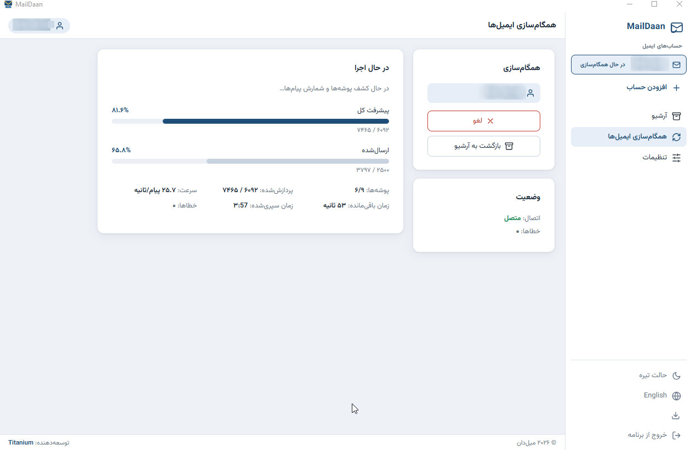
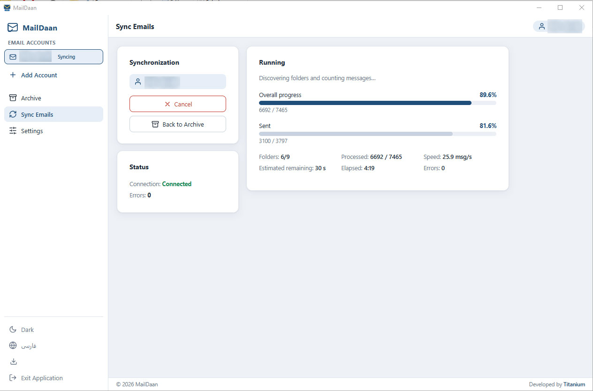
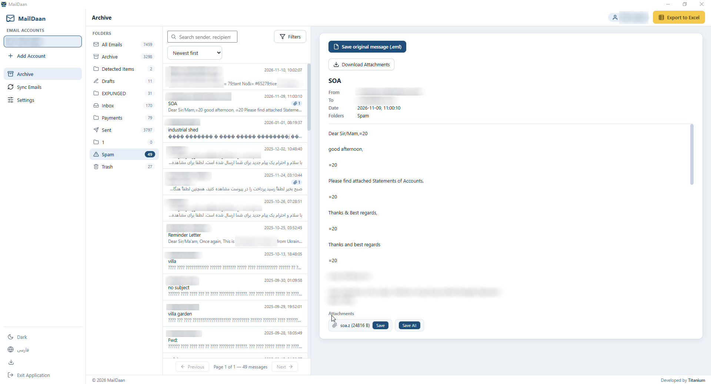

<div dir="rtl" align="right">

# میل‌دان (MailDaan)

**میل‌دان** برنامه‌ای **رایگان و متن‌باز** برای ویندوز است که با **پشتیبان‌گیری از
ایمیل‌ها**، آرشیویی کامل و محلی از آن‌ها روی همان رایانهٔ شما می‌سازد. کافی است
یک‌بار حساب ایمیل خود را به برنامه معرفی کنید تا همهٔ پیام‌ها و **فایل‌های پیوست**
دریافت و ذخیره شوند؛ از آن پس می‌توانید ایمیل‌ها را **بدون هیچ اتصال اینترنتی**
بخوانید، در میان آن‌ها جستجو کنید و از آن‌ها خروجی بگیرید.

رابط کاربری میل‌دان **دوزبانه (فارسی/انگلیسی)** است و زبان و جهت رابط را می‌توان در
هر لحظه تغییر داد.

> **[⬇ دانلود میل‌دان — نسخهٔ ۱.۴.۲](https://github.com/TahaSarhangi/maildaan/releases)**
>
> ویندوز ۱۰ و ۱۱ (۶۴ بیتی) · نصب کاملاً آفلاین و بدون نیاز به اینترنت

**زبان:** [فارسی](README.fa.md) · [English](README.md)

- **توسعه‌دهنده:** Titanium — [https://github.com/TahaSarhangi](https://github.com/TahaSarhangi)
- **نسخه:** ۱.۴.۲ (1.4.2)
- **پروانه:** MIT (متن پروانه در [LICENSE](LICENSE))

## چرا میل‌دان

ایمیل‌های شما دست خودتان می‌ماند. میل‌دان از همهٔ پیام‌های شما یک نسخهٔ محلی روی
**همان رایانهٔ شما** می‌گیرد و پس از آن، خواندن، جستجو و خروجی‌گیری از ایمیل‌ها به
**هیچ اتصال اینترنتی نیاز ندارد**. هیچ سرویس ابری، هیچ حساب کاربری روی سرویس‌های
شخص ثالث در کار نیست.

اتصال اینترنت **تنها برای دریافت ایمیل‌های جدید** و بررسی بروزرسانی‌های برنامه لازم
است، یعنی زمانی که میل‌دان باید پیام‌های تازه را از سرور ایمیل شما بخواند یا نسخه
جدید را چک کند. **مرور ایمیل‌های ذخیره‌شده**، جستجو در آن‌ها و نصب برنامه هرگز به
اینترنت نیاز ندارد.

## امکانات اصلی

- **پشتیبان‌گیری کامل از ایمیل‌ها** — همهٔ پوشه‌ها (صندوق دریافتی، ارسال‌شده،
  پیش‌نویس، هرزنامه و پوشه‌های سفارشی و تودرتو) به‌صورت خودکار شناسایی می‌شوند و
  متن کامل پیام‌ها، فایل‌های پیوست و فایل‌های اصلی `.eml` دریافت می‌شوند.
- **مدیریت چند حساب ایمیل** — می‌توانید چند حساب ایمیل را کنار هم پشتیبان بگیرید.
  هر حساب آرشیو کاملاً مستقل خود را دارد: پایگاه‌دادهٔ SQLite اختصاصی، فایل‌های
  `.eml`، پیوست‌ها، پوشه‌ها، نقطهٔ بازیابی و تنظیمات گواهی TLS مربوط به همان حساب.
- **دریافت سریع و هوشمند ایمیل‌های جدید** — میل‌دان با یادآوری نقطهٔ بازیابی (دو
  شناسهٔ `UID` و `UIDVALIDITY`) در هر بار فقط پیام‌های جدید را دریافت می‌کند. اگر
  دریافت نیمه‌تمام بماند، دقیقاً از همان نقطه از سر گرفته می‌شود و یک دستهٔ ناموفق
  هرگز نقطهٔ بازیابی را جابه‌جا نمی‌کند.
- **پشتیبان‌گیری از ایمیل‌ها با یا بدون پیوست** — می‌توانید ابتدا فقط متن پیام‌های
  یک پوشه را دریافت کنید تا آرشیو سریع‌تر ساخته شود و **دانلود فایل‌های پیوست**
  را به بعد موکول کنید؛ چه برای یک پیام و چه برای گروهی از پیام‌ها. میل‌دان هرگز
  پیوستی را که شما درخواست نکرده‌اید دانلود نمی‌کند.
- **بررسی نسخه جدید و مدیریت به‌روزرسانی درون برنامه** — آیکون کوچک به‌روزرسانی
  در نوار کناری، انتشار نسخه‌های جدید در گیت‌هاب را بررسی می‌کند و به محض آماده
  شدن نسخهٔ جدید به شما اطلاع می‌دهد. پیشرفت دانلود به‌صورت حلقه‌ای با درصد زنده
  روی همان آیکون نمایش داده می‌شود، صحت فایل دریافت‌شده با اثرانگشت SHA-256 تأیید
  می‌شود و سپس پیش از نصب صراحتاً از شما پرسیده می‌شود: **اکنون نصب کن** یا
  **بعداً یادآوری کن**. به‌محض انتخاب «اکنون نصب کن»، یک کارت پیشرفت بی‌درنگ ظاهر
  می‌شود، نسخهٔ در حال نصب را نشان می‌دهد و توضیح می‌دهد که میل‌دان برای کامل
  شدن به‌روزرسانی به‌طور خودکار بسته و دوباره باز می‌شود؛ این اقدام هرگز نمی‌تواند
  هم‌زمان دو بار اجرا شود. نصب در حین دریافت ایمیل‌های جدید هرگز انجام نمی‌شود و
  همگام‌سازی در جریان هرگز بدون اجازهٔ شما لغو نمی‌گردد.
- **پیام‌های خطای روشن و دوزبانه** — هر خطا (اتصال، سرور ایمیل، گواهی، خروجی‌گیری
  و …) به‌جای یک متن فنی خام، با پیامی روشن و به زبان فارسی یا انگلیسی به شما
  نمایش داده می‌شود.
- **جستجوی هوشمند در ایمیل‌های ذخیره‌شده** — جستجوی سریع روی فرستنده، گیرنده،
  موضوع و متن پیام‌ها، همراه با یکسان‌سازی نویسه‌های فارسی (ی/ي، ک/ك، اعراب و
  نیم‌فاصله)، تصحیح چیدمان کیبورد (اگر کلمهٔ فارسی را با کیبورد انگلیسی تایپ
  کردید باز هم پیدا می‌شود، و برعکس)، تحمل اشتباهات تایپی همراه با پیشنهاد
  «آیا منظورتان … بود؟» و فیلترهای تاریخ، پوشه و طرفین مکاتبه.
- **تاریخ‌های دوزبانه** — تاریخ پیام‌ها در رابط فارسی با **تقویم شمسی (جلالی)** و
  ارقام فارسی و در رابط انگلیسی با **تقویم میلادی** نمایش داده می‌شود.
- **رابط کاربری حرفه‌ای دسکتاپ** — نوار کناری دائمی، مرورگر سه‌بخشی (پوشه‌ها /
  فهرست پیام‌ها / جزئیات پیام)، پوسته‌های روشن و تاریک، فونت وزیرمتن برای رابط
  فارسی و امکان تغییر زبان و جهت رابط در هر زمان.
- **متن پیام‌ها قابل انتخاب و کپی** — موضوع، فرستنده و گیرندگان، تاریخ و متن
  پیامِ بازشده مانند هر متن معمولی قابل انتخاب است؛ با ماوس انتخاب کنید و با
  Ctrl+C (یا منوی راست‌کلیک) کپی کنید، در چیدمان فارسی (راست‌به‌چپ) و انگلیسی
  (چپ‌به‌راست) و برای هم پیام‌های متنی و هم پیام‌های HTML.
- **خروجی PDF یا PNG از یک پیام** — هر پیامِ بازشده را می‌توان از نوار ابزار همان
  پیام به‌صورت یک سند **PDF** یا یک تصویر **PNG** ذخیره کرد؛ خروجی شامل موضوع،
  تاریخ، فرستنده، گیرندگان (به/کپی، در صورت وجود) و متن پیام است و متن‌های فارسی،
  انگلیسی و ترکیبی راست‌به‌چپ/چپ‌به‌راست را به‌درستی نمایش می‌دهد. نام پیشنهادی
  فایل از موضوع و تاریخ ساخته می‌شود؛ همه‌چیز به‌صورت محلی روی رایانهٔ شما
  پردازش می‌شود و خروجی فایل `.eml` اصلی همچنان در کنار آن در دسترس است.
- **گزارش‌های قابل‌تنظیم اکسل** — در پنجرهٔ گزارش می‌توانید هدف گزارش (جامع،
  فعالیت، مخاطبان، دامنه‌ها یا پیام‌ها)، محدودهٔ دقیق آن (بازهٔ تاریخ، پوشه‌ها،
  جهت ایمیل، نحوهٔ پیش‌نویس‌ها و واژهٔ کلیدی اختیاری)، برگه‌ها و ستون‌های
  دلخواه و زبان گزارش را انتخاب کنید. هر گزارش یک کارگاه قالب‌بندی‌شده با
  خلاصهٔ مدیریتی، نمودار فعالیت ماهانه، فهرست پیام‌ها، آمار مخاطبان و
  دامنه‌های ایمیل و فهرست پیوست‌هاست؛ همهٔ برگه‌ها از همان محدودهٔ
  انتخاب‌شده استخراج می‌شوند و در گزارش فارسی تاریخ‌ها شمسی و چیدمان کارگاه
  راست‌به‌چپ است. گزارش‌ها هرگز به‌صورت خودکار ساخته نمی‌شوند؛ تنها با
  درخواست شما.
- **قفل ورود به برنامه با رمز عبور (اختیاری)** — می‌توانید ورود به میل‌دان را با
  رمز عبور محافظت کنید. رمز فقط به‌صورت **درهم‌ساز Argon2id** (و هرگز به‌صورت متن
  آشکار) ذخیره می‌شود. این قفل صرفاً کنترل ورود به برنامه است و **آرشیو ایمیل را
  رمزگذاری نمی‌کند**. همچنین عمداً هیچ راهی برای دور زدن یا بازنشانی این رمز
  پیش‌بینی نشده است.
- **حریم خصوصی در طراحی** — آرشیو شما در مسیر `%LOCALAPPDATA%\MailDaan` قرار دارد
  و هرگز در پوشهٔ برنامه نیست. رمز حساب ایمیل فقط در حافظه و تنها برای دریافت
  ایمیل‌های جدید نگه داشته می‌شود و هرگز روی دیسک نوشته نمی‌شود.

## سیستم‌عامل موردنیاز

- **ویندوز ۱۰ (نسخهٔ ۱۸۰۹ یا جدیدتر)** یا **ویندوز ۱۱**، فقط **۶۴ بیتی (x64)**
- زمان اجرای Microsoft .NET Framework نسخهٔ ۴.۶.۲ که پنجرهٔ دسکتاپ به آن نیاز دارد
  در همهٔ نسخه‌های پشتیبانی‌شدهٔ ویندوز ۱۰/۱۱ از پیش موجود است؛ نصب‌کننده این موضوع
  را بررسی می‌کند و در صورت نیاز، نسخهٔ رسمی و آفلاین آن را به‌صورت خودکار نصب
  می‌کند.

## نصب‌کنندهٔ کاملاً آفلاین

فایل `MailDaan-Setup-1.4.2.exe` یک نصب‌کنندهٔ یکپارچه و کاملاً مستقل است:

- زمان اجرای رسمی **Microsoft Edge WebView2 Fixed Version (۶۴ بیتی)** درون آن جای
  گرفته و میل‌دان از همین کپی اختصاصی استفاده می‌کند؛ بنابراین نصب **هرگز** زمان
  اجرای سیستمی WebView2 را دانلود، نصب یا درخواست نمی‌کند.
- کل برنامه درون همان فایل قرار دارد: زمان اجرای پایتون، همهٔ وابستگی‌ها،
  دارایی‌های رابط، فونت‌های وزیرمتن، آیکون‌ها و فایل‌های ترجمه.
- **در هیچ مرحله‌ای از نصب به اتصال اینترنت یا دانلود جانبی نیاز نیست.**
- برنامه در `Program Files` نصب می‌شود، میان‌برها را در منوی استارت می‌سازد،
  میان‌بر اختیاری دسکتاپ را پیشنهاد می‌دهد، یک حذف‌کنندهٔ استاندارد ثبت می‌کند و
  **هرگز** به داده‌های آرشیو شما دست نمی‌زند.

## تصاویر

این تصاویر در یک محیط واقعی ثبت شده‌اند؛ اطلاعات خصوصیِ موجود در آن‌ها تار شده
است تا هیچ دادهٔ کاربری فاش نشود.

<p float="right">
  
  
</p>

<p align="center">
  
</p>

## دانلود و نصب

1. فایل **`MailDaan-Setup-1.4.2.exe`** را از صفحهٔ
   [انتشارها (Releases)](https://github.com/TahaSarhangi/maildaan/releases) دانلود
   کنید.
2. آن را اجرا کنید — به اتصال اینترنت نیاز نیست. در صورت تمایل می‌توانید صحت فایل
   دانلودشده را با فایل `MailDaan-Setup-1.4.2.exe.sha256` منتشرشده بررسی کنید.
3. **میل‌دان** را از منوی استارت اجرا کنید (میان‌بر اختیاری دسکتاپ نیز پیشنهاد
   می‌شود).

آرشیو شما جدا از برنامه در مسیر `%LOCALAPPDATA%\MailDaan` ذخیره می‌شود و در
به‌روزرسانی‌ها و حتی حذف کامل برنامه حفظ می‌شود.

## استفادهٔ پایه

1. **در اولین اجرا زبان خود را انتخاب کنید** — فارسی یا انگلیسی؛ تغییر زبان در هر
   لحظه از نوار کناری ممکن است.
2. **حساب ایمیل خود را اضافه کنید** — نشانی سرور ایمیل (مثلاً `imap.gmail.com`)،
   پورت (پیش‌فرض `993`، ارتباط امن)، نشانی ایمیل و رمز عبور. میل‌دان برای دریافت
   ایمیل‌ها از پروتکل IMAP استفاده می‌کند؛ مطمئن شوید این گزینه در حساب ایمیل شما
   فعال باشد. رمز فقط برای همان همگام‌سازی استفاده می‌شود و هرگز ذخیره نمی‌شود.
   *(برای جیمیل: اگر حساب شما از تأیید دو مرحله‌ای استفاده می‌کند، یک رمز برنامه
   (app password) در تنظیمات امنیتی حساب گوگل بسازید. اگر دسترسی IMAP غیرفعال است،
   ممکن است نیاز باشد در تنظیمات جیمیل آن را فعال کنید.)*
3. **ایمیل‌های جدید را دریافت کنید** — اولین همگام‌سازی همهٔ پوشه‌های قابل دسترسی
   را دریافت می‌کند. روند کار، سرعت و زمان تخمینی در پنجرهٔ برنامه نمایش داده
   می‌شود. می‌توانید در هر لحظه آن را لغو کنید؛ پیام‌های دریافت‌شده نگه داشته
   می‌شوند و همگام‌سازی بعدی از همان نقطه ادامه پیدا می‌کند.
4. **ایمیل‌های ذخیره‌شده را مرور کنید** — بدون اتصال اینترنت پوشه‌ها را باز کنید،
   پیام‌ها را بخوانید، پیوست‌ها را ببینید و ذخیره کنید، یا فایل اصلی `.eml` را
   ذخیره کنید.
5. **جستجو کنید** — یک نام، موضوع یا هر متنی را تایپ کنید. اشتباهات چیدمان کیبورد
   فارسی/انگلیسی و بیشتر اشتباهات تایپی همچنان پیدا می‌شوند، همراه با پیشنهاد
   «آیا منظورتان … بود؟».
6. **ساخت گزارش اکسل (اختیاری)** — پنجرهٔ گزارش را باز کنید، هدف و محدودهٔ
   گزارش (تاریخ، پوشه‌ها، جهت، پیش‌نویس‌ها و واژهٔ کلیدی) و برگه‌های دلخواه
   را انتخاب کنید و یک کارگاه اکسل دوزبانه و قالب‌بندی‌شده با خلاصه‌ها،
   نمودارها و آمارها بسازید.

## تازه‌های نسخهٔ ۱.۴.۲

- **اصلاح خروجی PDF** — فایل تولیدشده با گزینهٔ *ذخیره به‌صورت PDF* در همهٔ
  برنامه‌های خواندن PDF به‌شدت مخدوش نمایش داده می‌شد. تصویر جای‌داده‌شده
  پیش‌پردازشگر ردیفی PNG را اعلام می‌کرد، ولی ردیف‌ها بدون پالایش نوشته می‌شدند؛
  در نتیجه برنامه‌های خواندن، تبدیل معکوس PNG-Sub را روی پیکسل‌های از پیش درست
  اعمال می‌کردند و هر صفحه را مخدوش می‌کردند — اعوجاج افقی، طیف‌های خاکستریِ
  تکرارشونده و رنگ‌های نادرست، در محتوای فارسی، انگلیسی و ترکیبی به‌یکسان. اکنون
  داده‌های تصویر به‌صورت ردیف‌های RGB فشرده و فیلترنشده، تنها با فشرده‌سازی Flate
  و بدون هیچ پیش‌پردازشگری نوشته می‌شوند تا هر صفحه دقیقاً همان‌گونه که میل‌دان
  آن را رسم کرده نمایش داده شود، در خروجی‌های یک‌صفحه‌ای و چندصفحه‌ای.
- **حفظ ترجیب زبان** — در برخی نصب‌ها پنجرهٔ انتخاب زبان، با وجود انتخاب پیشینِ
  زبان، در هر اجرا دوباره نمایش داده می‌شد. برنامه ترجیحات خود را با دنبالهٔ
  «خواندن → تغییر → ذخیره» می‌نوشت و چند کنش رابط (بررسی پس‌زمینهٔ به‌روزرسانی،
  افزودن یا انتخاب حساب، …) می‌توانستند همین دنباله را دقیقاً در لحظهٔ انتخاب
  زبان و هرکدام روی نخِ جداگانه‌ای اجرا کنند؛ هر رایتوری که دیرتر تمام می‌شد،
  تغییر دیگری را بی‌صدا بازنویسی می‌کرد و زبان ذخیره‌شده ناپدید می‌شد، در حالی که
  حساب‌ها، آرشیوها و سایر ترجیحات سالم می‌ماندند. اکنون هر تغییر ترجیبات به‌صورت
  اتمیک از محتوای فعلی فایل و زیر یک قفل واحد اعمال می‌شود، بنابراین هیچ کنش
  هم‌زمانی نمی‌تواند کنش دیگر را برگرداند — زبان انتخاب‌شده در راه‌اندازی‌های
  مجدد، راه‌اندازی مجدد ویندوز و به‌روزرسانی‌ها حفظ می‌شود. تغییر دستی زبان
  تغییر نکرده و هیچ ترجیب معتبرِ ذخیره‌شده‌ای با مقدار پیش‌فرض بازنویسی نمی‌شود.

## تازه‌های نسخهٔ ۱.۴.۱

- **بازخورد بی‌درنگ هنگام نصب به‌روزرسانی** — پس از انتخاب **اکنون نصب کن**، به‌جای
  یخ‌زدن پنجره تا ظاهر شدن درخواست اجازهٔ ویندوز، بی‌درنگ یک کارت پیشرفت نمایش
  می‌شود که نسخهٔ در حال نصب را نشان می‌دهد و توضیح می‌دهد میل‌دان خودکار بسته و
  دوباره باز می‌شود. امکان اجرای هم‌زمان دو نصب از بین رفته است و اگر نصب‌کننده
  نتواند اجرا شود (یا درخواست اجازهٔ آن رد شود)، برنامه باز می‌ماند، به وضعیت
  قابل‌استفاده بازمی‌گردد و خطا را به فارسی یا انگلیسی گزارش می‌کند — هرگز
  موفقیت را به‌صورت کاذب اعلام نمی‌کند.
- **قابل انتخاب و کپی شدن متن پیام‌ها** — موضوع، فرستنده و گیرندگان، تاریخ و متن
  پیامِ بازشده اکنون متن معمولی و قابل انتخاب است. با ماوس انتخاب کنید و با Ctrl+C
  یا منوی راست‌کلیک کپی کنید؛ برای پیام‌های متنی و HTML و در فارسی (راست‌به‌چپ)،
  انگلیسی (چپ‌به‌راست) و ترکیبی. این تغییر روی انتخاب پیام‌ها در فهرست (کلیک،
  Ctrl+کلیک، Shift+کلیک، حالت چک‌باکس) یا هیچ کنترل دیگری تأثیری ندارد.
- **ذخیرهٔ یک پیام به‌صورت PDF یا PNG** — نمای بازشدهٔ پیام اکنون در کنار خروجی
  `.eml` موجود، گزینه‌های **ذخیره به‌صورت PDF** و **ذخیره به‌صورت PNG** را دارد.
  هر دو یک خروجی خوانا از همان یک پیام — موضوع، تاریخ، فرستنده، گیرندگان (به/کپی
  در صورت وجود) و متن — تولید می‌کنند که متن‌های فارسی، انگلیسی و ترکیبی
  راست‌به‌چپ/چپ‌به‌راست را به‌درستی نمایش می‌دهد و نام پیشنهادی فایل از موضوع و
  تاریخ ساخته می‌شود. همهٔ پردازش به‌صورت محلی روی همان رایانه انجام می‌شود.

## تازه‌های نسخهٔ ۱.۴.۰

- **حذف انعطاف‌پذیر حساب** — حذف یک حساب اکنون با دو گزینهٔ روشن ارائه می‌شود.
  «حذف حساب از برنامه» فقط ثبتِ حساب را پاک می‌کند و آرشیو محلی آن (پایگاه داده،
  فایل‌های `.eml` و پیوست‌ها) روی کامپیوتر شما باقی می‌ماند؛ این آرشیو هنگام
  افزودن دوبارهٔ همان صندوق پستی به‌صورت خودکار متصل می‌شود. «حذف حساب و تمام
  اطلاعات» علاوه بر آن، پس از یک تأیید دوم، پوشهٔ آرشیو محلی حساب را از این
  کامپیوتر پاک می‌کند — هیچ‌چیز روی سرور ایمیل هرگز تغییر نمی‌کند. حذف حساب در
  حال همگام‌سازی مسدود است.
- **تأیید پیش از لغو همگام‌سازی** — لغو یک همگام‌سازی در حال اجرا اکنون ابتدا
  تأیید می‌گیرد («آیا مطمئن هستید که می‌خواهید فرایند همگام‌سازی ایمیل‌ها را لغو
  کنید؟» / "Are you sure you want to cancel email synchronization?") تا کلیک
  ناخواسته هرگز یک دریافت طولانی را قطع نکند. پیام‌های دانلودشده همچنان نگه
  داشته می‌شوند و همگام‌سازی بعدی از همان نقطهٔ بازیابی ادامه می‌یابد.
- **دکمهٔ بستن در پنجرهٔ به‌روزرسانی** — پنجرهٔ «شما در حال استفاده از آخرین
  نسخه هستید» اکنون دکمهٔ **بستن** خود را در کنار «بررسی دوباره» دارد و دیگر
  نیازی به بستن از طریق خود پنجره نیست.
- **حذف ایمیل‌ها از آرشیو محلی** — یک یا چند ایمیل را (حالت انتخاب با چک‌باکس،
  Ctrl-کلیک، Shift-کلیک برای یک بازه، «انتخاب همه» / «لغو انتخاب») انتخاب کنید و
  با یک تأیید از آرشیو محلی حذف کنید. نسخه‌های روی سرور ایمیل هرگز تحت تأثیر
  قرار نمی‌گیرند و پیام‌های حذف‌شده در یک همگام‌سازی معمولی دوباره دانلود
  نمی‌شوند. حذف در نمایش یک پوشه تنها نسخهٔ همان پوشه را پاک می‌کند؛ اگر همان
  ایمیل در پوشهٔ دیگری هم باشد، آن نسخه دست‌نخورده باقی می‌ماند.
- **همگام‌سازی بسیار پایدارتر** — یک پیام معیوب دیگر نباید کل همگام‌سازی را
  متوقف کند یا ناتمام رها کند: پیام‌های ناموفق جدا می‌شوند، اگر مشکل گذرا باشد
  یک‌بار در همان اجرا دوباره تلاش می‌شوند و در غیر این صورت برای همگام‌سازی
  بعدی ثبت می‌گردند، در حالی که بقیه پیام‌ها به دریافت ادامه می‌دهند. نقطهٔ
  بازیابی اکنون روی هر پیامی که واقعاً کامل شده پیش می‌رود؛ بنابراین همگام‌سازی
  بعدی هرگز پیام‌های موفق را دوباره دریافت نمی‌کند و پیام‌های ناموفق هم هرگز
  جا نمی‌مانند.
- **اصلاح نام فایل‌های پیوستِ خیلی طولانی یا فارسی** — برخی فرستنده‌ها نام فایل
  را به‌صورت خامِ کدگذاری‌شده با درصد (مثلاً `%D8%A7%DB%8C...`) می‌فرستند نه
  کدگذاری استاندارد؛ آرشیو متن ناخوانا را نگه می‌داشت و با نام‌های خیلی طولانی
  می‌توانست از محدودیت طول مسیر ویندوز عبور کند و کل پیام را ناموفق کند. اکنون
  محتوای پیوست‌ها زیر نام‌های کوتاه و قطعی ذخیره می‌شوند، در حالی که نام اصلی
  خوانا نگه داشته می‌شود و هنگام ذخیرهٔ فایل استفاده می‌گردد؛ و یک پیوست
  ناخوانا دیگر باعث حذف کل پیام یا سایر پیوست‌ها نمی‌شود.
- **گزارش روشن‌تر پایان همگام‌سازی** — گزارش همگام‌سازی اکنون پیام‌های جدید،
  پیام‌های از پیش آرشیوشده (تکثیر حذف‌شده)، پیام‌های ناموفق یا ناتمام، پیوست‌های
  ناموفق یا معوق و پیام‌های پرش‌شده به‌خاطر حذف محلی را از هم متمایز می‌کند —
  همراه با فهرستی محدود و پاک‌سازی‌شده از پیام‌هایی که به همگام‌سازی دیگری
  نیاز دارند.

## تازه‌های نسخهٔ ۱.۳.۱

- **اصلاح راه‌اندازی نصب‌کننده و راه‌اندازی مجدد برنامه در به‌روزرسانی** — مدیریت
  به‌روزرسانی اکنون از شل ویندوز برای اجرای نصب‌کنندهٔ تأییدشده با ارتقای مناسب
  UAC (`ShellExecuteW("runas")`) استفاده می‌کند. فراخوانی قبلی `subprocess.Popen`
  نمی‌توانست پرامپت ارتقا را فعال کند، که باعث می‌شد برنامه بسته شود بدون اینکه
  چیزی نصب گردد. میل‌دان اکنون به‌صورت تمیز بسته می‌شود، نصب‌کننده با ارتقای
  مجوزها و جدا از شل اجرا می‌گردد و برنامه پس از اتمام نصب به‌صورت خودکار مجدداً
  راه‌اندازی می‌شود.
- **تأیید یک‌باره و دوزبانه موفقیت به‌روزرسانی** — پس از راه‌اندازی مجدد، برنامه
  بررسی می‌کند که نسخهٔ نصب‌شده با نسخهٔ سپرده‌شده به نصب‌کننده یکسان باشد؛ در
  صورت تطابق دقیق، یک پیام تأیید تک‌باره («بروزرسانی کامل شد» / "Update Complete")
  به زبان فعال رابط نمایش داده می‌شود. این رکورد بلافاصله پاک می‌شود تا پیام هرگز
  بیش از یک‌بار نشان داده نشود. یک نصب لغوشده یا ناموفق، یا راه‌اندازی مجدد در
  نسخهٔ متفاوت، بی‌صدا می‌ماند — برنامه هرگز به‌صورت کاذب موفقیت را اعلام نمی‌کند.
- **نمایش نسخهٔ برنامه در پاورقی پنجره** — شماره نسخهٔ جاری اکنون در پاورقی
  نمایش داده می‌شود («نسخه ۱.۳.۱» در رابط فارسی، "Version 1.3.1" در رابط
  انگلیسی)، با ارقام فارسی در رابط فارسی و ارقام لاتین در رابط انگلیسی.

## تازه‌های نسخهٔ ۱.۳.۰

- **گزارش‌های اکسل حرفه‌ای و پیکربندی‌پذیر** — هدف‌های آماده، انتخاب دقیق
  محدوده (بازهٔ تاریخ، پوشه‌ها، جهت، پیش‌نویس‌ها و واژهٔ کلیدی)، کنترل دقیق
  برگه‌ها و ستون‌ها، و خلاصهٔ زندهٔ محدوده همراه با تعداد پیام‌های منطبق.
- **خلاصه‌های مدیریتی و تحلیل مکاتبات** — شاخص‌های خلاصهٔ مدیریتی (کل
  پیام‌ها، دریافتی، ارسالی و پیش‌نویس‌ها، مخاطبان و دامنه‌های یکتا، حجم
  پیوست‌ها و اولین/آخرین پیام)، نمودارهای فعالیت ماهانه و پرارتباط‌ترین
  مخاطبان و دامنه‌ها.
- **آمار مخاطبان و دامنه‌های ایمیل** — تعداد پیام‌های دریافتی و ارسالی هر
  مخاطب، تاریخ‌های فعالیت و گزارش جداگانهٔ دامنه‌های اختصاصی و سرویس‌های
  ایمیل عمومی.
- **دقت در شمارش پیام‌های دریافتی و ارسالی** — جهت ایمیل از نشانی‌های خود
  حساب و نام‌های مستعار آن تشخیص داده می‌شود، پیش‌نویس‌ها در دستهٔ خودشان
  قرار می‌گیرند و خود حساب از رده‌بندی مخاطبان و دامنه‌ها کنار گذاشته
  می‌شود، در حالی که همکارانتان روی همان دامنه همچنان محاسبه می‌شوند.
- **تاریخ شمسی در گزارش‌های فارسی** — برچسب ماه‌های شمسی، عناوین و نمودارهای
  ترجمه‌شده و برگه‌های راست‌به‌چپ؛ گزارش‌های انگلیسی میلادی و چپ‌به‌راست
  می‌مانند.
- **چیدمان حرفه‌ای کاربرگ‌ها** — ردیف سرتیتر ثابت همراه با فیلترهای کارا،
  فونت‌های متناسب با زبان و اندازهٔ خوانای پیوست‌ها (کیلوبایت/مگابایت/گیگابایت).
- **جای‌گزین‌ها و زمان‌سنج‌های بومی‌سازی‌شده** — همهٔ جای‌گزین‌ها و راهنماهای
  فرم از زبان فعال پیروی می‌کنند و روند همگام‌سازی با قالب‌بندی زبان‌آگاه و
  ارقام فارسی در رابط فارسی نمایش داده می‌شود.

## اجرا از روی کد منبع

<div dir="ltr">

```bat
git clone https://github.com/TahaSarhangi/maildaan.git
cd maildaan
python -m pip install -r requirements.txt
run-dev.bat
```

</div>

نیازمند پایتون ۳.۱۱ به بعد روی ویندوز است. برای ساخت فایل اجرایی و نصب‌کنندهٔ
کاملاً آفلاین، ابتدا `build.bat` و سپس `build-installer.bat` را اجرا کنید (ببینید
بخش [نصب‌کنندهٔ کاملاً آفلاین](#نصبکننده-کاملا-آفلاین) و `installer/prerequisites/README.txt`).

## پروانه‌ها و کتابخانه‌های شخص ثالث

میل‌دان با **پروانهٔ MIT** منتشر شده است — متن کامل در [LICENSE](LICENSE).

- **فونت وزیرمتن** — Copyright © 2015 Saber Rastikerdar و مشارکت‌کنندگان، با پروانهٔ
  SIL Open Font License 1.1 (ببینید [third-party-licenses](third-party-licenses)).
- **IMAPClient** — BSD 3-Clause · **openpyxl** — MIT · **pywebview** — BSD 3-Clause ·
  **argon2-cffi** — MIT · **RapidFuzz** — MIT.
- **Microsoft Edge WebView2 Fixed Version Runtime (۶۴ بیتی)** — یک جزء قابل توزیع
  رایگان از مایکروسافت که برای استفادهٔ کاملاً آفلاین درون پوشهٔ برنامه جای گرفته
  است، تحت شرایط پروانهٔ مایکروسافت
  (<https://learn.microsoft.com/microsoft-edge/webview2/>). ممکن است نسخهٔ رسمی و
  آفلاین .NET Framework نیز درون نصب‌کننده جای گرفته باشد؛ برای جزئیات به
  `installer/PREREQUISITES.txt` نگاه کنید.

---

**میل‌دان (MailDaan)** — پشتیبان‌گیری از ایمیل‌ها و مرور آفلاینِ رایگان، متن‌باز و
دوزبانه برای ویندوز. **Developed by Titanium** — [https://github.com/TahaSarhangi](https://github.com/TahaSarhangi)

</div>