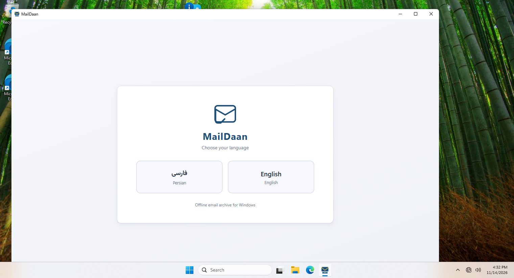
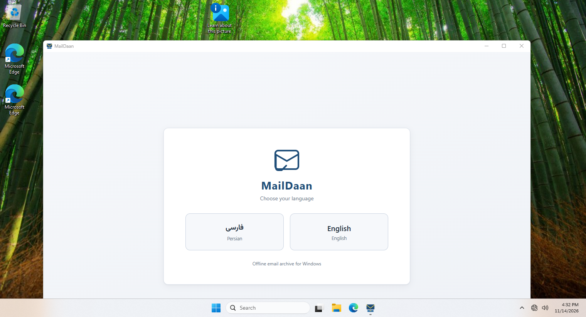

# میل‌دان (MailDaan)

**میل‌دان** یک **آرشیو و مرورگر آفلاین ایمیل**، رایگان و متن‌باز برای ویندوز است. این
برنامه **دوزبانه (فارسی/انگلیسی)** است، از یک حساب ایماپ (IMAP) همهٔ پیام‌ها و
پیوست‌ها را دریافت و در یک آرشیو کاملاً محلی ذخیره می‌کند و سپس امکان مرور، جستجو و
خروجی‌گیری از ایمیل‌ها را **کاملاً به‌صورت آفلاین** فراهم می‌کند.

**زبان:** [فارسی](README.fa.md) · [English](README.md)

- **سازنده:** Titanium — https://github.com/TahaSarhangi
- **نسخه:** ۱.۱.۳ (1.1.3)
- **پروانه:** MIT (متن پروانه در [LICENSE](LICENSE))

## چرا میل‌دان

ایمیل‌های شما در اختیار خودتان می‌ماند. میل‌دان پیام‌های شما را در **آرشیویی محلی روی
همان رایانهٔ شما** کپی می‌کند؛ پس از آن، خواندن، جستجو و خروجی‌گیری از ایمیل‌ها به
**هیچ اتصال اینترنتی نیاز ندارد**. هیچ سرویس ابری، هیچ حساب کاربری روی سرویس
شخص ثالث و هیچ خروج اطلاعاتی از رایانهٔ شما وجود ندارد.

اتصال اینترنت **تنها برای دریافت ایمیل‌های جدید** از سرور ایماپ لازم است. نصب
برنامه و همچنین مرور یا جستجوی آرشیو موجود، هرگز به اینترنت نیاز ندارد.

## امکانات اصلی

- **آرشیو کامل ایماپ** — همهٔ پوشه‌های قابل انتخاب (صندوق دریافتی، ارسال‌شده، پیش‌نویس،
  هرزنامه، پوشه‌های سفارشی و تودرتو) شناسایی شده و محتوای کامل پیام‌ها، پیوست‌ها و
  فایل‌های اصلی `.eml` دریافت می‌شوند.
- **چند حساب ایمیل مستقل** — می‌توانید چند حساب ایماپ را کنار هم آرشیو کنید. هر حساب
  آرشیو کاملاً جداگانهٔ خود را دارد: پایگاه‌دادهٔ SQLite اختصاصی، فایل‌های `.eml`،
  پیوست‌ها، پوشه‌ها، نقطهٔ بازیابی همگام‌سازی و تنظیمات گواهی TLS مربوط به همان حساب.
- **همگام‌سازی افزایشی** — با استفاده از نقطه‌بندی `UID` و `UIDVALIDITY` ایماپ، هر
  همگام‌سازی فقط موارد جدید را دریافت می‌کند. اگر همگام‌سازی قطع شود، دقیقاً از همان
  نقطه از سر گرفته می‌شود و یک دستهٔ ناموفق هرگز نقطهٔ بازیابی را جابه‌جا نمی‌کند.
- **جستجوی هوشمند آفلاین** — ایندکس سریع SQLite FTS5 روی فرستنده، گیرنده، موضوع و
  متن پیام‌ها، همراه با یکسان‌سازی نویسه‌های فارسی (ی/ي، ک/ك، اعراب، نیم‌فاصله)،
  تصحیح چیدمان کیبورد (تایپ کلمهٔ فارسی با کیبورد انگلیسی و برعکس)، تحمل خطای تایپی
  با پیشنهاد «آیا منظورتان … بود؟»، و فیلترهای تاریخ، پوشه و طرفین مکاتبه.
- **تاریخ‌های دوزبانه** — تاریخ پیام‌ها در رابط فارسی با **تقویم شمسی (جلالی)** و
  ارقام فارسی، و در رابط انگلیسی با **تقویم میلادی** نمایش داده می‌شود.
- **رابط کاربری حرفه‌ای دسکتاپ** — نوار کناری دائمی، مرورگر سه‌بخشی آرشیو (پوشه‌ها /
  فهرست پیام‌ها / جزئیات پیام)، پوسته‌های روشن و تاریک، فونت وزیرمتن برای رابط فارسی،
  و امکان جابه‌جایی در هر زمان بین فارسی (راست‌چین) و انگلیسی (چپ‌چین).
- **گزارش‌های اکسل (اختیاری)** — خروجیِ نمای فعلی (یا کل آرشیو) به یک کارگاه اکسل
  قالب‌بندی‌شده با برگه‌های **پیام‌ها**، **مخاطبان** و **سازمان‌ها**. گزارش‌ها هرگز
  به‌صورت خودکار ساخته نمی‌شوند — تنها با درخواست شما.
- **رمز عبور برنامه (اختیاری)** — محافظت از ورود به میل‌دان با رمزی که فقط به‌صورت
  **درهم‌ساز Argon2id** (هرگز به‌صورت متن آشکار) ذخیره می‌شود. این قفل فقط سطح
  دسترسی به برنامه است — آرشیو ایمیل را **رمزگذاری نمی‌کند** و عمداً هیچ راهی برای
  دور زدن یا بازنشانی رمز وجود ندارد.
- **حریم خصوصی در طراحی** — آرشیو شما در `%LOCALAPPDATA%\MailDaan` و هرگز در پوشهٔ
  برنامه قرار ندارد. رمز ایماپ فقط در حافظه و تنها برای همگام‌سازی فعال نگه داشته
  می‌شود و هرگز روی دیسک نوشته نمی‌شود.

## سازگاری با ویندوز

- **ویندوز ۱۰ (نسخهٔ ۱۸۰۹ یا جدیدتر)** یا **ویندوز ۱۱**، فقط **۶۴ بیتی (x64)**
- زمان اجرای Microsoft .NET Framework نسخهٔ ۴.۶.۲ که پنجرهٔ دسکتاپ به آن نیاز دارد،
  در تمام نسخه‌های پشتیبانی‌شدهٔ ویندوز ۱۰/۱۱ از پیش موجود است؛ نصب‌کننده این موضوع
  را بررسی می‌کند و در صورت نبود، redistributable رسمی و آفلاین آن را به‌صورت خودکار
  نصب می‌کند.

## نصب‌کنندهٔ کاملاً آفلاین

فایل `MailDaan-Setup-1.1.3.exe` یک نصب‌کنندهٔ یکپارچه و کاملاً مستقل است:

- **زمان اجرای Microsoft Edge WebView2 Fixed Version (۶۴ بیتی)** به‌صورت رسمی درون آن
  جای گرفته و میل‌دان از این کپی اختصاصی استفاده می‌کند؛ بنابراین نصب **هرگز** هیچ
  زمان اجرای WebView2 سیستمی را نصب، دانلود یا درخواست نمی‌کند.
- کل برنامه را در خود جای دارد: زمان اجرای پایتون، همهٔ وابستگی‌های بومی، دارایی‌های
  رابط، فونت‌های وزیرمتن، آیکون‌ها و فایل‌های محلی‌سازی.
- **در هیچ مرحله‌ای از نصب به اتصال اینترنت یا دانلود جانبی نیاز نیست.**
- برنامه در `Program Files` نصب می‌شود، میان‌برها را در منوی استارت می‌سازد، میان‌بر
  اختیاری دسکتاپ را پیشنهاد می‌دهد، یک حذف‌کنندهٔ استاندارد ثبت می‌کند و **هرگز** به
  داده‌های آرشیو شما دست نمی‌زند.

## تصاویر

هر دو تصویر در جریان یک تست پذیرش خودکار و آفلاین در یک Windows Sandbox تمیز (بدون
حساب ایمیل پیکربندی‌شده) گرفته شده‌اند و هیچ دادهٔ کاربری در آن‌ها وجود ندارد.

<p float="right">
  
  
</p>

## دانلود و نصب

1. فایل **`MailDaan-Setup-1.1.3.exe`** را از صفحهٔ
   [Releases](https://github.com/TahaSarhangi/maildaan/releases) دانلود کنید.
2. آن را اجرا کنید — به اتصال اینترنت نیاز نیست. می‌توانید صحت فایل دانلودی را هر
   زمان با فایل کنترلی `MailDaan-Setup-1.1.3.exe.sha256` منتشرشده بررسی کنید.
3. **میل‌دان** را از منوی استارت اجرا کنید (میان‌بر اختیاری دسکتاپ نیز پیشنهاد می‌شود).

آرشیو شما به‌صورت جداگانه در `%LOCALAPPDATA%\MailDaan` ذخیره می‌شود و در به‌روزرسانی‌ها
و حتی حذف برنامه حفظ می‌شود.

## استفادهٔ پایه

1. **زبان خود را در اولین اجرا انتخاب کنید** (فارسی یا انگلیسی؛ در هر زمان از نوار
   کناری قابل تغییر است).
2. **حساب ایمیل خود را اضافه کنید** — سرور ایماپ (مثلاً `imap.gmail.com`)، پورت
   (پیش‌فرض `993`، ایماپ روی TLS)، نشانی ایمیل و رمز عبور. رمز فقط برای همان
   همگام‌سازی استفاده می‌شود و هرگز ذخیره نمی‌شود.
   *(برای جیمیل: IMAP را در تنظیمات جیمیل فعال کنید و یک رمز برنامه (app password)
   بسازید.)*
3. **همگام‌سازی** — اولین همگام‌سازی همهٔ پوشه‌های قابل دسترسی را دریافت می‌کند. روند،
   سرعت و زمان تخمینی در پنجرهٔ برنامه نمایش داده می‌شود. می‌توانید در هر لحظه لغو
   کنید؛ پیام‌های دریافت‌شده نگه داشته می‌شوند و همگام‌سازی بعدی از نقطهٔ بازیابی
   از سر گرفته می‌شود.
4. **مرور آفلاین** — پوشه‌ها را باز کنید، پیام‌ها را بخوانید، پیوست‌ها را ببینید و
   ذخیره کنید، یا فایل اصلی `.eml` را ذخیره کنید.
5. **جستجو** — یک نام، موضوع یا هر متنی را تایپ کنید. اشتباهات چیدمان کیبورد
    فارسی/انگلیسی و بیشتر اشتباهات تایپی همچنان پیدا می‌شوند، همراه با پیشنهاد
    «آیا منظورتان … بود؟».
6. **خروجی اکسل (اختیاری)** — از محدودهٔ جستجو/فیلتر فعلی، یا از کل آرشیو وقتی هیچ
   فیلتری فعال نیست، یک کارگاه اکسل بسازید.

## اجرا از روی کد منابع

```bat
git clone https://github.com/TahaSarhangi/maildaan.git
cd maildaan
python -m pip install -r requirements.txt
run-dev.bat
```

نیازمند پایتون 3.11+ روی ویندوز است. برای ساخت فایل اجرایی و نصب‌کنندهٔ کاملاً
آفلاین، ابتدا `build.bat` و سپس `build-installer.bat` را اجرا کنید (نگاه کنید به
بخش [نصب‌کنندهٔ کاملاً آفلاین](#نصبکننده-کاملا-آفلاین) و
`installer/prerequisites/README.txt`).

## پروانه‌ها و اعتباردهی‌های شخص ثالث

میل‌دان تحت **پروانهٔ MIT** منتشر شده است — متن کامل در [LICENSE](LICENSE).

- **فونت وزیرمتن** — Copyright © 2015 Saber Rastikerdar و مشارکت‌کنندگان، تحت پروانهٔ
  SIL Open Font License 1.1 (نگاه کنید به [third-party-licenses](third-party-licenses)).
- **IMAPClient** — BSD 3-Clause · **openpyxl** — MIT · **pywebview** — BSD 3-Clause ·
  **argon2-cffi** — MIT · **RapidFuzz** — MIT.
- **Microsoft Edge WebView2 Fixed Version Runtime (۶۴ بیتی)** — یک اجزای قابل
  توزیع رایگان از مایکروسافت که برای استفادهٔ کاملاً آفلاین درون پوشهٔ برنامه
  جای گرفته است، تحت شرایط پروانهٔ مایکروسافت
  (<https://learn.microsoft.com/microsoft-edge/webview2/>). redistributable رسمی و
  آفلاین .NET Framework نیز ممکن است درون نصب‌کننده جای گرفته باشد؛ برای جزئیات
  به `installer/PREREQUISITES.txt` نگاه کنید.

---

**میل‌دان (MailDaan)** — آرشیو و کاوش آفلاین، رایگان، متن‌باز و دوزبانهٔ ایمیل برای
ویندوز. **Developed by Titanium** — https://github.com/TahaSarhangi
