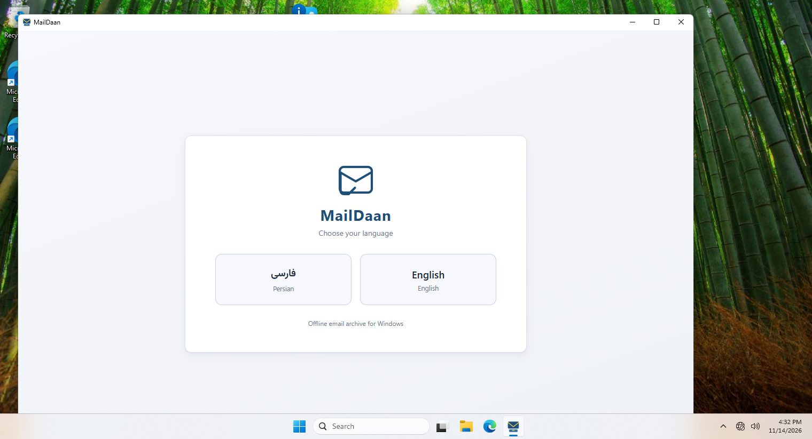
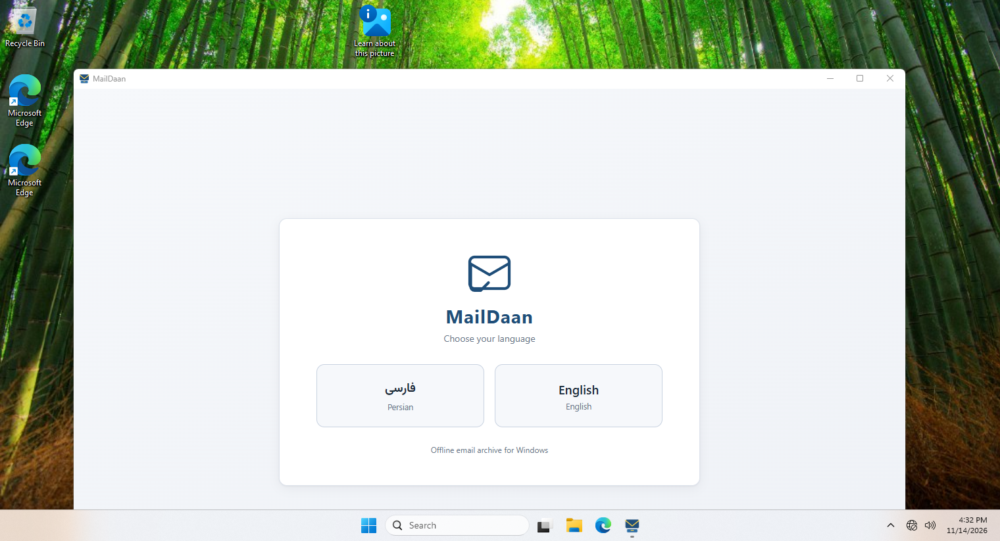

# MailDaan

**MailDaan** (میل‌دان) is a free, open-source, **offline email archive and explorer** for
Windows. It speaks **Persian and English**, connects to any IMAP account, downloads every
accessible message and attachment into a fully local archive, and then lets you browse,
search and export your email — **completely offline**.

**Language:** [English](README.md) · [فارسی (Persian)](README.fa.md)

- **Developer:** Titanium — https://github.com/TahaSarhangi
- **Version:** 1.2.0
- **License:** MIT (see [LICENSE](LICENSE))

## Why MailDaan

Your email stays yours. MailDaan copies your messages into a **local archive on your own
machine** — after that, reading, searching and exporting your email needs **no internet
connection at all**. There is no cloud, no account on any third-party service, and no
data leaving your computer.

An internet connection is required **only to download new email** from your IMAP server.
Installing the application, and browsing or searching an existing archive, never needs one.

## Main features

- **Complete IMAP archiving** — discovers every selectable folder (Inbox, Sent, Drafts,
  Spam, custom and nested folders) and downloads full message content, attachments and the
  original `.eml` files.
- **Multiple independent accounts** — archive several IMAP accounts side by side. Each
  account keeps its own separate archive: its own SQLite database, `.eml` files,
  attachments, folders, sync checkpoints and TLS trust settings.
- **Incremental synchronization** — IMAP `UID` + `UIDVALIDITY` checkpoints make every sync
  download only what is new. An interrupted sync resumes exactly where it stopped, and a
  failed batch never advances the checkpoint.
- **Sync with or without attachments** — download a folder's messages first and fetch their
  attachments later, on demand for one message or a whole selection at a time. MailDaan
  never auto-downloads attachments you did not ask for.
- **Built-in update manager** — the small update icon in the sidebar checks GitHub for new
  releases, lights up a badge when one is available, shows the download as a circular
  progress ring with a live percentage, verifies the installer against its published
  SHA-256 checksum, and then asks explicitly before installing: **Install now** or
  **Remind me later**. It never installs while a synchronization is running and never
  cancels one without your consent.
- **Clear bilingual errors** — every failure (connection, IMAP, certificate, export, …)
  is reported as a concrete, human-readable message in Persian or English instead of a
  raw technical error.
- **Intelligent offline search** — a fast SQLite FTS5 index across senders, recipients,
  subjects and bodies, with Persian character normalization (ی/ي, ک/ك, diacritics, ZWNJ),
  keyboard-layout correction (typing a Persian word on an English layout still finds it,
  and vice versa) and typo-tolerant *"Did you mean …?"* suggestions, plus date, folder and
  participant filters.
- **Bilingual dates** — message dates are shown in the **Persian Jalali** calendar with
  Persian digits in the Persian interface, and in the **Gregorian** calendar in English.
- **Professional desktop interface** — persistent sidebar, three-pane archive explorer
  (folders / message list / message detail), light and dark themes, bundled Vazirmatn font
  for the Persian UI, switchable between Persian (RTL) and English (LTR) at any time.
- **Optional Excel reports** — export the current view (or the whole archive) to a formatted
  workbook with **Messages**, **Contacts** and **Organizations** sheets. Reports are never
  generated automatically — only when you ask for one.
- **Optional application password** — protect entry into MailDaan with a password stored
  as an **Argon2id hash** (never in plaintext). This is an application-level access lock
  only — it does **not** encrypt the archive, and there is deliberately no password-reset
  bypass.
- **Private by design** — your archive lives in `%LOCALAPPDATA%\MailDaan`, never inside the
  application folder. Your IMAP password is kept in memory **only** for the active
  synchronization and is never written to disk.

## Windows compatibility

- **Windows 10 (version 1809 or later)** or **Windows 11**, **64-bit (x64) only**
- The Microsoft .NET Framework 4.6.2 runtime used by the desktop window is already part of
  every supported Windows 10/11 build; the installer verifies this and can install the
  bundled official offline redistributable automatically if it is ever genuinely missing.

## Completely offline installer

`MailDaan-Setup-1.2.0.exe` is a single, fully self-contained setup program:

- It embeds the official **Microsoft Edge WebView2 Fixed Version Runtime (x64)** and uses
  that private copy, so setup **never installs, downloads or asks for** a system WebView2
  runtime.
- It contains the complete application: Python runtime, all native dependencies, UI assets,
  Vazirmatn fonts, icons and localizations.
- **No internet connection and no separate downloads are needed at any point** during
  installation.
- It installs to `Program Files`, creates Start Menu shortcuts, offers an optional desktop
  shortcut, registers a standard uninstaller, and **never touches** your archive data.

## Screenshots

Both screens were captured during an automated offline acceptance test in a clean Windows
Sandbox (no email account configured), so they contain no user data.

<p float="left">
  
  
</p>

## Download and install

1. Download **`MailDaan-Setup-1.2.0.exe`** from the
   [Releases](https://github.com/TahaSarhangi/maildaan/releases) page.
2. Run it — no internet connection is required. Verify the download anytime against the
   published `MailDaan-Setup-1.2.0.exe.sha256` checksum file.
3. Launch **MailDaan** from the Start Menu (an optional desktop shortcut is offered).

Your archive is stored separately in `%LOCALAPPDATA%\MailDaan` and survives updates and
uninstallations.

## Basic usage

1. **Choose your language** on first launch (Persian or English; switchable later at any
   time from the sidebar).
2. **Add your email account** — IMAP server (for example `imap.gmail.com`), port
   (default `993`, IMAP over TLS), email address and password. The password is used only
   for that synchronization and is never stored.
   *(For Gmail: enable IMAP in Gmail settings and generate an app password.)*
3. **Synchronize** — the first sync downloads every accessible folder. Progress, speed and
   estimated time are shown in the application window. You can cancel at any time;
   completed downloads are kept and the next sync resumes from the checkpoint.
4. **Browse offline** — open folders, read messages, view and save attachments, or save the
   original `.eml` file.
5. **Search** — type a name, subject or any text. Persian/English keyboard-layout mistakes
   and most typos are still found, with *"Did you mean …?"* suggestions.
6. **Export to Excel** (optional) — generate a workbook from the current search/filter
   scope, or from the whole archive when no filters are active.

## Run from source

```bat
git clone https://github.com/TahaSarhangi/maildaan.git
cd maildaan
python -m pip install -r requirements.txt
run-dev.bat
```

Requires Python 3.11+ on Windows. To build the executable and the fully offline installer,
run `build.bat` then `build-installer.bat` (see
[build the fully offline installer](#completely-offline-installer) above and
`installer/prerequisites/README.txt`).

## Third-party licenses and attribution

MailDaan is licensed under the **MIT License** — see [LICENSE](LICENSE).

- **Vazirmatn font** — Copyright © 2015 Saber Rastikerdar and contributors, licensed under
  the SIL Open Font License 1.1 (see [third-party-licenses](third-party-licenses)).
- **IMAPClient** — BSD 3-Clause · **openpyxl** — MIT · **pywebview** — BSD 3-Clause ·
  **argon2-cffi** — MIT · **RapidFuzz** — MIT.
- **Microsoft Edge WebView2 Fixed Version Runtime (x64)** — a free Microsoft redistributable
  bundled inside the application folder for fully offline use, under Microsoft's license
  terms (<https://learn.microsoft.com/microsoft-edge/webview2/>). The official .NET Framework
  offline redistributable may also be embedded; see `installer/PREREQUISITES.txt`.

---

**MailDaan** — free, open-source bilingual offline email archiving and exploration for
Windows. **Developed by Titanium** — https://github.com/TahaSarhangi
